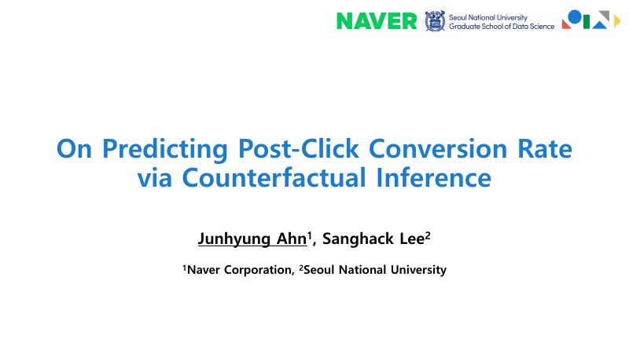

<h2 class="bibliography">2026</h2>
<ol class="bibliography"><li>
  

    

      
Information-Theoretic Causal Bounds under Unmeasured Confounding

      
<em>iSchool Research Showcase</em>, University of Illinois Urbana-Champaign

      

        <a href="/files/poster_ischool_showcase_202610.pdf" class="btn btn-sm z-depth-0" role="button" target="_blank">PDF</a>
      

    

    

      
    

  

</li></ol>
<h2 class="bibliography">2025</h2>
<ol class="bibliography"><li>
  

    

      
On Predicting Post-Click Conversion Rate via Counterfactual Inference

      
<em>IEEE International Conference on Data Mining (ICDM)</em>

      

        <a href="/files/slides_icdm_2025.pdf" class="btn btn-sm z-depth-0" role="button" target="_blank">PDF</a>
      

    

    

      
    

  

</li></ol>

