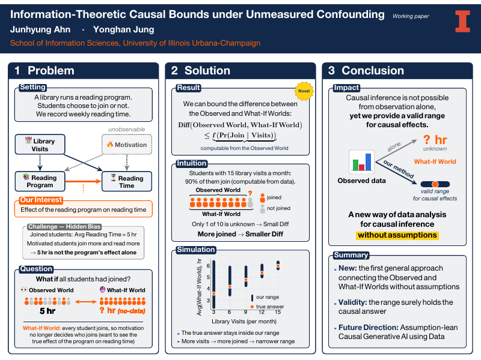

<h2 class="bibliography">2026</h2>
<ol class="bibliography"><li>
  

    

      
Information-Theoretic Causal Bounds under Unmeasured Confounding

      
<em>iSchool Research Showcase</em>, University of Illinois Urbana-Champaign, Oct 2026

      
We bound the gap between the observed world and the what-if world with quantities computable from observed data, which gives a valid range for causal effects.

      

        <a href="/files/poster_ischool_showcase_202610.pdf" class="btn btn-sm z-depth-0" role="button" target="_blank">PDF</a>
      

    

    

      
    

  

</li></ol>

